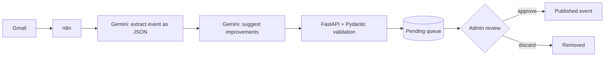

# CampusFlow

**One place for everything happening at IME-USP.**

CampusFlow is a communication platform for the Institute of Mathematics and Statistics at the University of São Paulo. It gathers events, talks, academic notices and opportunities into a single feed, so students stop finding out about things by luck.

It's a solo project, built by [me](https://github.com/Henriquewtd-cyber) for the **Prêmio Pipa** (Prêmio Incentivo à Participação em Atividades) at IME-USP.

## Why this exists

At IME, information lives in too many places: institutional e-mail, WhatsApp and Telegram groups, social media, bulletin boards and word of mouth. Nobody knows where to look, and things get missed.

Before writing any code, I surveyed the community (135 people) to check that this was a real problem and not just my impression:

- **51%** had already missed an event, deadline or opportunity because they didn't see the information in time
- **68%** use institutional e-mail as their main channel, and it's also the one people complain about most
- **90%** said a centralized platform would be useful or very useful

CampusFlow is the answer to those numbers.

## What it does

- **Event feed:** events, notices, talks and news in one place, with filters by type, area, audience and period
- **Event pages:** date, time, location, organizer, description and a sign-up link
- **TV panel:** a rotating view made for screens around the institute, with QR codes so people can grab the link on their phones
- **Admin panel:** a standardized way for student groups, professors and administrative offices to publish and edit content
- **AI-assisted publishing:** events sent by e-mail are read, structured and suggested for publication automatically, and a human always has the final say (more below)

The interface is in Portuguese, since that's who it's for.

## How the AI part works

Most announcements at IME already go out by e-mail, so instead of asking organizers to learn a new tool, CampusFlow reads the e-mails and turns them into events.



1. **n8n** reads incoming e-mails through the Gmail API.
2. A first call to **Gemini (Flash)** extracts the event into structured JSON.
3. A second call suggests improvements to the fields (clearer titles, missing details, and so on).
4. n8n sends the original fields and the suggestions to the **FastAPI** backend, where **Pydantic** validates the format.
5. The event lands in a **pending queue**. An admin reviews it, using the AI suggestions or not, and approves it. Only then does it become a real event.

The AI never publishes anything on its own. It does the tedious part, and a person makes the call.

**How well does it work?** In a test with 30 e-mails in very different formats, 29 were handled correctly: 24 of the 25 that contained events were extracted with all fields right, and the 5 that weren't events were ignored.

## Tech stack

| Layer | Tools |
|---|---|
| Frontend | Next.js, TypeScript, Tailwind CSS |
| Backend | FastAPI, Pydantic |
| Database | PostgreSQL |
| Automation & AI | n8n, Gmail API, Gemini API (Flash) |
| Infra | Docker, Docker Compose, Make |

## Running locally

You'll need [Docker](https://docs.docker.com/get-docker/) and `make`.

First, create a `.env` file with the project's environment variables. Then:

```bash
make build   # builds the Docker images
make up      # starts everything
```

The frontend will be available at [http://localhost:3000](http://localhost:3000).

n8n also starts with the rest of the stack, but it needs to be configured (Gmail and Gemini credentials) before the e-mail pipeline works. In production, n8n runs as a separate, already configured service.

## Status

CampusFlow is fully implemented and running locally. The launch as an official, active IME-USP platform is planned for **December 2026**.

## About

Built by **Henrique Wagner Thomé Dias**, Computer Science student at IME-USP, as an individual project for the Prêmio Pipa.

- GitHub: [Henriquewtd-cyber](https://github.com/Henriquewtd-cyber)
- LinkedIn: [henrique-wagner](https://www.linkedin.com/in/henrique-wagner/)